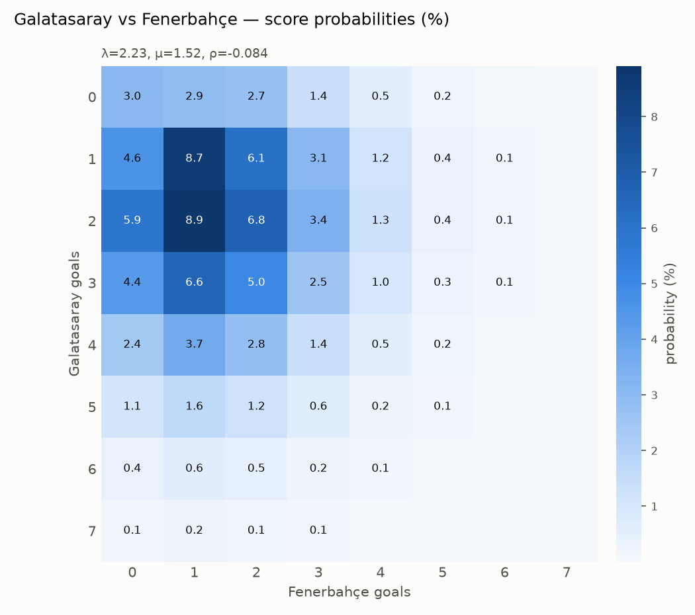
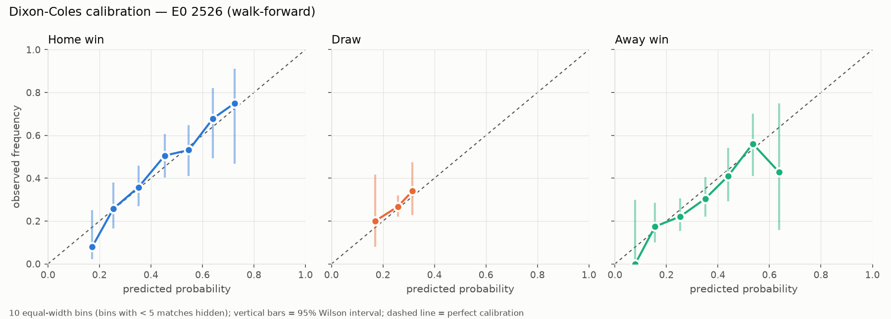
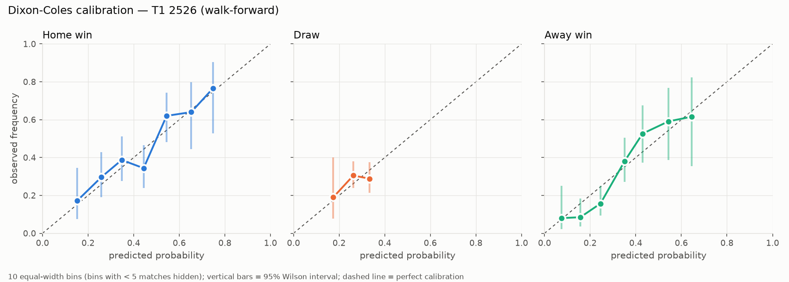
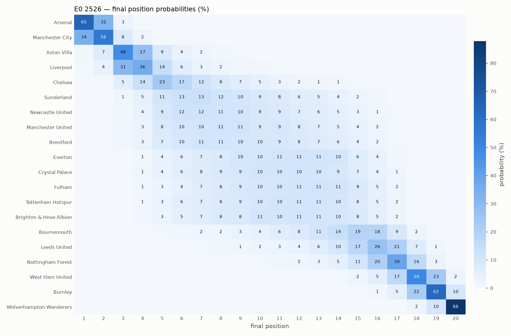
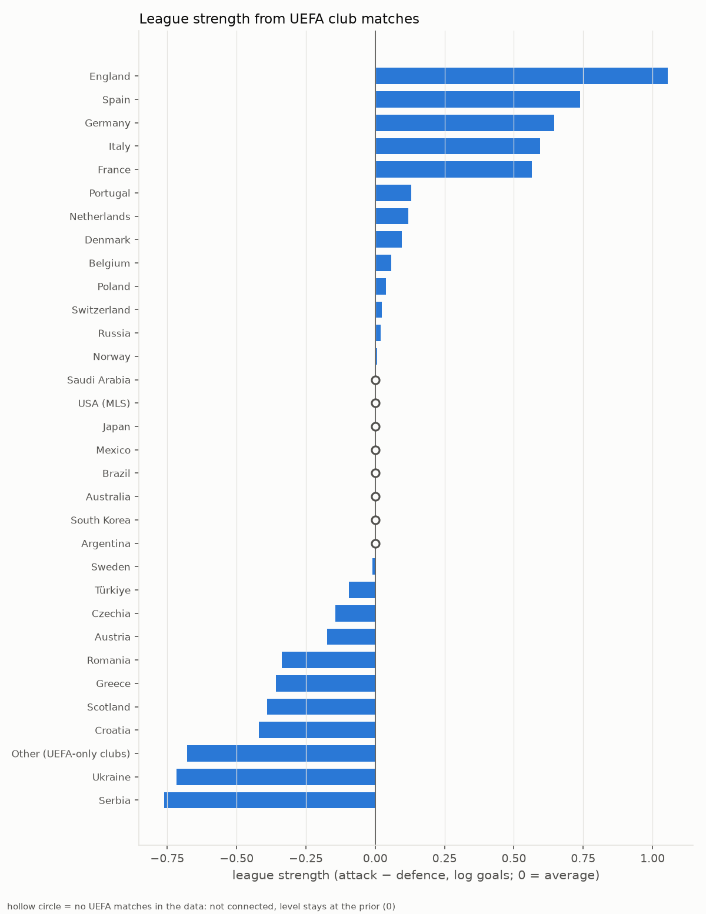
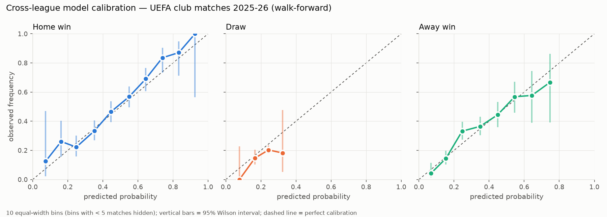
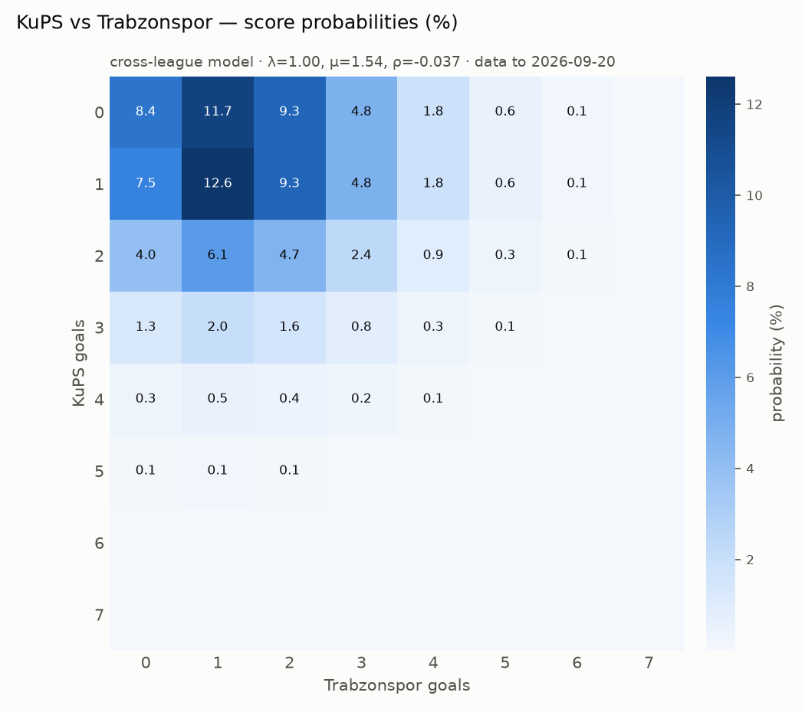

# football-predictor

Zaman ağırlıklı **Poisson + Dixon-Coles** modeliyle futbol maçlarının skor olasılıklarını tahmin eden, sonuçlarını zaman sıralı ve dürüst biçimde değerlendiren bir Python aracı.

> ⚠️ **Eğitim amaçlıdır, bahis tavsiyesi değildir.** Bu proje istatistiksel modellemeyi göstermek için yazıldı. Aşağıdaki sonuçlar, modelin bahis piyasasını yendiğine dair hiçbir kanıt sunmaz.

## Öne çıkanlar

- **Model:** Dixon-Coles temelli, zaman ağırlıklı Poisson modeli. Üzerine isabetli şut verisi, kadro piyasa değeri önseli ve 31 lig ile UEFA kupalarını tek ölçekte birleştiren hiyerarşik bir ligler arası model eklendi.
- **Dürüst değerlendirme:** her maç yalnızca o maçtan önceki verilerle, haftalık yeniden eğitimle tahmin edildi. Rastgele bölme yok; sızıntı testlerle denetleniyor. Ayarların hepsi doğrulama sezonunda seçildi, test sezonuna dokunulmadı.
- **2025-26 sonuçları (Süper Lig + Premier Lig, 686 maç):**
  - Son model ilk modelden istatistiksel olarak anlamlı şekilde daha iyi.
  - Basit taban çizgisinden bahis piyasasına kadar olan log-loss farkının yaklaşık **%83'ü** kapatıldı.
  - **Model piyasayı yenmiyor**; kalan fark ve muhtemel nedenleri aşağıda açıkça raporlanıyor.
- **Canlı testler:** maç öncesi saat damgası ve SHA-256 özetiyle kaydedilen tahminler ([`docs/predictions/`](docs/predictions/)).

<p align="center"></p>

## Kurulum

Python 3.10+ gerekir.

```bash
git clone https://github.com/OguzZ73/football-predictor.git
cd football-predictor
python -m venv .venv && source .venv/bin/activate
pip install .            # geliştirme için: pip install -e ".[dev]"
```

Bağımlılıklar: `pandas`, `numpy`, `scipy`, `statsmodels`, `matplotlib` (testler için `pytest`).

## Hızlı başlangıç

```bash
pip install ".[kaggle]"   # Transfermarkt kaynağı için; ~/.kaggle/access_token gerekir
football-predictor download --league T1 --source transfermarkt --seasons 2018-2026  # eksiksiz geçmiş
football-predictor download --league T1 --seasons 2026-2027                         # devam eden sezon (openfootball)
football-predictor train --league T1                          # ξ'yi doğrulama sezonunda seçer, models/T1.json
football-predictor predict "Galatasaray" "Fenerbahce" --league T1
football-predictor evaluate --league T1                       # zaman sıralı test + kalibrasyon grafiği
football-predictor simulate-season --league T1 --n 10000      # kalan sezonun Monte Carlo simülasyonu
```

Takım adları büyük/küçük harf ve Türkçe karakterlere duyarsız eşleşir (`fenerbahce` → `Fenerbahçe`). Ad belirsizse öneriler gösterilir. Bütün çıktılar (`.csv`, `.png`) `outputs/` altına yazılır. README'deki her sayı ve görsel `scripts/reproduce.sh` ile yeniden üretilebilir.

### Örnek çıktı

```
$ football-predictor predict "Galatasaray" "Fenerbahçe" --league T1

Galatasaray (home) vs Fenerbahçe (away)   [T1, model data to 2026-09-07]
Expected goals     2.16 - 1.43
--------------------------------------
Home win (1)        53.4%
Draw (X)            22.3%
Away win (2)        24.4%
--------------------------------------
Over 2.5 goals      69.4%
Under 2.5 goals     30.6%
Both teams score    68.0%
--------------------------------------
Most likely scores
  1-1                9.4%
  2-1                9.2%
  3-1                6.6%
  2-2                6.6%
  2-0                6.5%
```

## Veri

| Kaynak | Komut | İçerik |
|---|---|---|
| [Transfermarkt (Kaggle)](https://www.kaggle.com/datasets/davidcariboo/player-scores) | `--source transfermarkt` | **README sonuçlarının ana kaynağı.** CC0 lisanslı, düzenli güncellenen veri seti; T1 ve E0 için 2018-19 … 2025-26 eksiksiz (SP1, D1, I1 de destekleniyor). Bahis oranı yok. Ücretsiz bir [Kaggle API token](https://www.kaggle.com/settings)'ı ve `pip install ".[kaggle]"` gerekir. |
| [openfootball](https://github.com/openfootball) (varsayılan) | `--source openfootball` | Kamu malı Football.TXT dosyaları, token gerekmez. Burada **devam eden sezon** (2026-27) için kullanılıyor. T1 ve E0. T1'de 2021-22 ve 2022-23 yok, 2025-26 yalnızca 99 maç. |
| [TFF maç listeleri (GitHub)](https://github.com/betul-bostan/super-lig-match-outcome-prediction) | `--source tff-github` | Yalnızca T1, Kaggle token'ı olmayanlar için openfootball'daki 2021-23 boşluğunu doldurur. Depoda lisans belirtilmemiş: kişisel/eğitim amaçlı kullanın, veriyi yeniden dağıtmayın. |
| [Oyuncu piyasa değerleri (Transfermarkt, Kaggle)](https://www.kaggle.com/datasets/davidcariboo/player-scores) | `kaggle datasets download davidcariboo/player-scores -f player_valuations.csv -p data/_transfermarkt --unzip` | CC0. Kadro değeri önseli için; ilk kullanımda aylık kadro değeri tablosu `data/_transfermarkt/squad_values.csv` olarak oluşturulur (2018-2026, 103 anlık görüntü). |
| [Bahis oranları (Kaggle derlemesi)](https://www.kaggle.com/datasets/adamgbor/club-football-match-data-2000-2025) | `kaggle datasets download adamgbor/club-football-match-data-2000-2025 -f Matches.csv -p data/_odds --unzip` | football-data.co.uk'ten derlenmiş Bet365 maç öncesi oranları, 42 lig, 2000-2026. `data/_odds/Matches.csv` olarak kaydedilince oranlar maçlara tarih ve takım adı eşlemesiyle kendiliğinden bağlanır (5.809 maçta 1 skor farkı). Yalnızca ülke ligleri; UEFA kupaları yok. Lisans belirtilmemiş: kişisel/eğitim amaçlı kullanın. |
| [football-data.co.uk](https://www.football-data.co.uk) | `--source football-data` | Sonuçlar **ve bahis oranları**. Geliştirme yapılan ağda erişim engelliydi (DNS bir "erişime engellenmiş" sayfasına yönleniyordu), bu yüzden README sonuçlarında kullanılmadı. Erişiminiz varsa değerlendirme tablosuna kapanış oranlarından bir **piyasa** satırı otomatik eklenir. |

Kaynaklar birleştirilebilir: bir indirme, **daha fazla maç içeren** mevcut bir sezon dosyasının üzerine yazmaz (`--force` ile zorlanabilir). `scripts/reproduce.sh` önce Transfermarkt'tan 2018-26 geçmişini, sonra openfootball'dan devam eden sezonu indirir.

İşleme adımları (`data.py`):
- Yalnızca `Date, HomeTeam, AwayTeam, FTHG, FTAG` kullanılır (football-data'da ayrıca oranlar). Tarihi, golü bozuk olan veya bir takımın kendisiyle eşleştiği satırlar atılır. Tekrar eden satırlar silinir.
- **Hükmen / masa başı sonuçlar atılır**, çünkü sahada oynanmadılar:
  - 2022-23'te depremden sonra çekilen Hatayspor ve Gaziantep FK'nin 29 maçı. Transfermarkt'ta hakem, teknik direktör ve diziliş alanları boş, skor 3-0/0-3; bu kural tam olarak bu 29 maçı yakalıyor ve TFF'nin hükmen listesiyle birebir örtüşüyor.
  - Galatasaray - Adana Demirspor (9 Şubat 2025): Adana Demirspor 1-1'de sahadan çekildi, maç 3-0 hükmen sayıldı. Hakem verisi dolu olduğu için açık bir istisna listesiyle (`TRANSFERMARKT_AWARDED`) atılıyor.
- **Takım adları** normalize edilir: `FC`/`AFC` ekleri atılır, sponsorlu ve farklı yazılmış adlar eşlenir (`Atiker Konyaspor`, `Basaksehir FK` → `İstanbul Başakşehir`, `YUKATEL KAYSERİSPOR` → `Kayserispor` …). Transfermarkt eşleme tablosu tahminle değil, 2018-2025 maçlarını diğer kaynaklarla **tarih + skor üzerinden eşleştirerek** çıkarıldı; her ad tek bir karşılığa düştü (yalnızca 2025-26'da yükselen Kocaelispor 11, diğerleri 34-304 maçta).
- Football.TXT'de yıl yazılmayan tarihler bir önceki tarihten ileri doğru çıkarılır (Temmuz 2020'deki COVID sonrası maçlar doğru yıla düşer).
- Ham veri `data/` altında tutulur ve repoya eklenmez (`.gitignore`).

**Kaynak tutarlılığı.** Transfermarkt, openfootball ve TFF verisi ortak oldukları 5.581 maçta karşılaştırıldı:
- **E0:** 2018-26'nın 3.040 maçının hepsinde skorlar birebir aynı. Bu yüzden E0 sonuçları kaynak değişince hiç değişmedi.
- **T1:** tek bir fark var. MKE Ankaragücü - Alanyaspor (12 Mart 2023) TFF verisinde 1-2, Transfermarkt'ta 2-0. TFF'deki maç bağlantısı artık başka bir maça gittiği için doğrulanamadı; Transfermarkt değeri kullanılıyor.
- **openfootball'un kaçırdıkları:** 2024-25 sezonunun son haftasındaki 4 maç.

**Veri kapsamı (2026-10-15 itibarıyla):**

| Lig | Sezonlar | Maç | Not |
|---|---|---|---|
| T1 Süper Lig | 2018-19 … 2025-26 eksiksiz, 2026-27* | 2.788 | 2022-23: 313 oynanmış maç (29 hükmen atıldı), 2024-25: 341 (1 hükmen atıldı). *2026-27 openfootball'dan, 36 maç (7 Eylül 2026'ya kadar). |
| E0 Premier League | 2018-19 … 2025-26 eksiksiz, 2026-27* | 3.090 | *2026-27 openfootball'dan, 50 maç (20 Eylül 2026'ya kadar). |

## Yöntem

### 1. Poisson regresyonu

$h$ ev sahibi, $a$ deplasman takımı olsun. Gol sayıları $X$ (ev) ve $Y$ (deplasman) için:

$$
\log \lambda = \alpha_h + \beta_a + \gamma, \qquad \log \mu = \alpha_a + \beta_h
$$

$$
X \sim \text{Poisson}(\lambda), \qquad Y \sim \text{Poisson}(\mu)
$$

- $\alpha_i$: hücum gücü (büyük = çok gol atar)
- $\beta_i$: savunma zayıflığı (büyük = çok gol yer)
- $\gamma$: herkes için ortak ev sahibi avantajı

Model belirlenebilir olsun diye $\sum_i \alpha_i = 0$ kısıtı konur. Bu durumda genel gol seviyesini $\beta$'lar taşır.

### 2. Dixon-Coles düzeltmesi

Bağımsız Poisson modeli düşük skorlu sonuçları sistematik olarak yanlış tahmin edebilir. Dixon ve Coles (1997), ortak olasılığı bir $\tau$ çarpanıyla düzeltir:

$$
P(X=x, Y=y) = \tau_{\lambda,\mu}(x,y)\,\frac{\lambda^x e^{-\lambda}}{x!}\,\frac{\mu^y e^{-\mu}}{y!}
$$

$$
\tau_{\lambda,\mu}(x,y) =
\begin{cases}
1 - \lambda\mu\rho & x=0,\ y=0 \\
1 + \lambda\rho & x=0,\ y=1 \\
1 + \mu\rho & x=1,\ y=0 \\
1 - \rho & x=1,\ y=1 \\
1 & \text{diğer}
\end{cases}
$$

$\rho < 0$ olduğunda 0-0 ve 1-1 olasılıkları artar, 1-0 ve 0-1 azalır. $\rho = 0$ olduğunda model düz Poisson'a indirgenir.

### 3. Zaman ağırlığı ve tahmin

Parametreler, ağırlıklı log-olabilirliği maksimize ederek bulunur:

$$
\hat\theta = \arg\max_\theta \; \sum_{k} w_k \log P(x_k, y_k \mid \theta) \;-\; \frac{\kappa}{2}\Big(\sum_i \alpha_i^2 + \sum_i (\beta_i - \bar\beta)^2\Big),
\qquad w_k = e^{-\xi\, t_k}
$$

Burada $t_k$, maçın tahmin tarihinden kaç gün önce oynandığıdır. $\xi$ büyüdükçe eski maçlar daha hızlı unutulur (yarı ömür $\ln 2/\xi$).

- **Optimizasyon:** `scipy.optimize` L-BFGS-B, analitik gradyanla. Kendi yazdığımız olabilirlik, $\rho=0$ ve $\kappa=0$ iken `statsmodels` Poisson GLM ile aynı $\lambda$ değerlerini verir. Bu eşitlik bir testle doğrulanıyor (`tests/test_model.py::test_matches_statsmodels_glm`).
- **Hafif L2 cezası ($\kappa = 2$):** Az maç oynamış takımların (ör. sezon başındaki yeni yükselenler) parametrelerinin sonsuza kaçmasını engeller. Değer, **yalnızca doğrulama sezonlarında** iki ligin ortalama log-loss'una göre seçildi (κ ∈ {0.5, 2, 5, 10, 20}). Test sezonlarına bakılmadı.
- **Hiç görülmemiş takım:** Eğitim verisinde hiç olmayan bir takıma, son sezonun en zayıf 4 takımının ortalama parametreleri verilir (yeni yükselen takım varsayımı).

### 4. Skor matrisi ve türetilen olasılıklar

Her maç için 0-0'dan 7-7'ye kadar 8×8 bir olasılık matrisi $P_{xy}$ üretilir. 7 golü aşan kütle atılıp matris yeniden normalize edilir; tipik oranlarda (λ ≤ 2.2) kaybolan kütle %0.2'nin altındadır (test ediliyor). Matristen şunlar türetilir:

- **1-X-2:** $\sum_{x>y} P_{xy}$, $\sum_{x} P_{xx}$, $\sum_{x<y} P_{xy}$
- **Üst/Alt 2.5:** $\sum_{x+y>2.5} P_{xy}$
- **Karşılıklı gol (BTTS):** $\sum_{x\ge1,\,y\ge1} P_{xy}$
- **En olası 5 skor**

### 5. Monte Carlo sezon simülasyonu

Kalan her fikstür için skor matrisinden `n` kez skor örneklenir (vektörize, `seed=42`). Puan tablosu oynanmış maçlar üzerine eklenir. Sıralama puan, averaj, atılan gol ve kalan eşitliklerde rastgele seçimle yapılır (ikili averaj modellenmez). Çıktı olarak takım başına şampiyonluk, ilk *k* (Avrupa) ve son *k* (küme düşme) olasılıkları ile tüm sıra olasılıklarının ısı haritası üretilir. Avrupa ve düşme kontenjanları yaklaşık varsayılanlardır (T1: ilk 4 / son 3, E0: ilk 5 / son 3); kupa galipleri gibi istisnalar yok sayılır. `--europe` ve `--relegation` ile değiştirilebilir.

### 6. İsabetli şut verisi (etkin gol)

Gol, şansa çok bağlı bir ölçüdür; isabetli şut sayısı ise takımın pozisyon üretme gücünü daha kararlı biçimde gösterir. Model, olabilirliğin Poisson kısmında gol yerine bir **etkin gol** kullanır:

$$
x^{etkin} = \alpha \cdot \text{gol} + (1-\alpha) \cdot \text{isabetli şut} \times \frac{\sum \text{gol}}{\sum \text{isabetli şut}}
$$

- **Dönüşüm oranı:** her fitte yalnızca o fitin eğitim maçlarından hesaplanır (Süper Lig ve Premier Lig'de yaklaşık 0.32).
- **α'nın anlamı:** α = 1 eski modelin aynısıdır.
- **α'nın seçimi:** ξ ile birlikte doğrulama sezonunda yapılır (α ∈ {1, 0.75, 0.5, 0.25}).
- **ρ:** Dixon-Coles düzeltmesi gerçek skorlar üzerinden kalır.
- **Veri:** isabetli şutlar, bahis oranlarıyla aynı football-data derlemesinden gelir.

### 7. Kadro piyasa değeri önseli

L2 cezası takım gücünü 0'a (lig ortalamasına) değil, **kadro değerinden tahmin edilen güce** doğru çeker:

$$
\frac{\kappa}{2}\sum_i \big(\alpha_i - b_a z_i\big)^2 + \frac{\kappa}{2}\sum_i \big(\beta_i - \bar\beta - b_d z_i\big)^2
$$

- **$z_i$:** takımın standartlaştırılmış log kadro değeri.
- **$b_a$, $b_d$:** değer ile güç arasındaki ilişkinin katsayıları; model bunları kendisi tahmin eder.
- **Nasıl hesaplanır:** bir tarihteki kadro değeri, her oyuncunun o tarihten önceki **son** Transfermarkt değerinin (en fazla 1 yıl eski) oyuncunun o andaki kulübüne yazılmasıyla bulunur. Model hiçbir zaman ileri tarihli bir değeri görmez.
- **Verisi az takımlar:** yeni yükselen ya da az maç oynamış bir takım, ortalama bir takım gibi değil, kadrosunun değerine uygun bir güçle başlar.
- **Ne zaman kullanılır:** yalnızca doğrulama sezonunda değersiz modelden daha iyiyse; L2 gücü de aynı sezonda seçilir.

## Değerlendirme

**Kurulum, sızıntıyı önleyecek şekilde tamamen zaman sıralıdır:**

1. **Bölme:** son tamamlanmış sezon test, ondan önceki sezon doğrulama (ξ seçimi), daha öncekiler geçmiş verisidir. Rastgele bölme yoktur.
2. **Kayan (walk-forward) tahmin:** Test sezonundaki her maç, yalnızca o haftanın **pazartesisinden önce** oynanmış maçlarla eğitilen bir modelle tahmin edilir. Model her hafta yeniden eğitilir.
3. **Sızıntı testi:** `tests/test_evaluate.py::test_walk_forward_never_sees_the_future`, bir kesim tarihinden sonraki **bütün sonuçları değiştirir** ve kesimden önceki tahminlerin birebir aynı kaldığını doğrular.
4. **Metrikler:** log-loss, Ranked Probability Score (RPS, sıralı 1 < X < 2), çok sınıflı Brier skoru ve doğruluk.
5. **Taban çizgileri:** (a) her zaman ev sahibi kazanır, (b) eğitim dönemindeki sınıf frekansları, (c) düz Poisson (ρ = 0, aynı ξ ile).

### Sonuçlar

Her iki ligde de doğrulama (2024-25) aynı ayarları seçti: **ξ = 0.0075, α = 0.5 (yarı gol, yarı şut), kadro değeri önseli açık**. Ablasyon satırları, eklemelerin katkısını aynı ξ ile ayrı ayrı gösterir.

**Süper Lig (T1)**, test **2025-26** (geçmiş 2018-19 … 2023-24):

| Model | n | Log-loss ↓ | RPS ↓ | Brier ↓ | Doğruluk ↑ |
|---|---|---|---|---|---|
| Her zaman ev sahibi | 306 | 19.9783* | 0.4330 | 1.1569 | 0.4216 |
| Sınıf frekansları | 306 | 1.0846 | 0.2248 | 0.6569 | 0.4216 |
| Dixon-Coles, yalnız gol (ilk model) | 306 | 1.0004 | 0.1956 | 0.5979 | 0.4935 |
| + isabetli şut (α = 0.5) | 306 | 0.9941 | 0.1944 | 0.5959 | 0.5098 |
| **+ şut + kadro değeri (son model)** | 306 | **0.9859** | **0.1918** | **0.5903** | **0.5131** |
| Bahis piyasası (Bet365) | 306 | 0.9661 | 0.1850 | 0.5768 | 0.5392 |
| Karışım (doğrulamada seçilen: 0·model + 1·piyasa) | 306 | 0.9661 | 0.1850 | 0.5768 | 0.5392 |

**Premier League (E0)**, test **2025-26** (geçmiş 2018-19 … 2023-24):

| Model | n | Log-loss ↓ | RPS ↓ | Brier ↓ | Doğruluk ↑ |
|---|---|---|---|---|---|
| Her zaman ev sahibi | 380 | 19.8144* | 0.4368 | 1.1474 | 0.4263 |
| Sınıf frekansları | 380 | 1.0865 | 0.2280 | 0.6572 | 0.4263 |
| Dixon-Coles, yalnız gol (ilk model, ξ = 0.005) | 380 | 1.0331 | 0.2102 | 0.6201 | 0.4605 |
| + isabetli şut (α = 0.5) | 380 | **1.0278** | **0.2085** | **0.6167** | **0.4921** |
| + şut + kadro değeri (son model, κ = 0.5) | 380 | 1.0293 | 0.2090 | 0.6175 | 0.4763 |
| Bahis piyasası (Bet365) | 380 | 1.0185 | 0.2057 | 0.6115 | 0.4895 |
| Karışım (doğrulamada seçilen: 0.55·model + 0.45·piyasa) | 380 | 1.0204 | 0.2065 | 0.6123 | 0.4816 |

\* "Her zaman ev sahibi" kesin (%100) tahmin yaptığı için, ev sahibinin kazanamadığı her maçta log-loss sonsuz olur. Tablodaki değer olasılıklar 1e-15'te kırpılarak hesaplandı. Deterministik tahminin neden bu kadar ağır cezalandırıldığını gösteriyor.

**Eşleştirilmiş log-loss farkları** (maç bazında, %95 güven aralığı; negatif = ilk model daha iyi):

| Karşılaştırma | T1 | E0 | İki lig birlikte |
|---|---|---|---|
| Son model − ilk model | **−0.0145** (−0.0265 … −0.0025) | −0.0038 (−0.0137 … +0.0060) | **−0.0086** (−0.0163 … −0.0009) |
| Şut − ilk model | −0.0063 (−0.0196 … +0.0070) | −0.0053 (−0.0162 … +0.0056) | −0.0058 (−0.0142 … +0.0027) |
| Kadro değeri − yalnız şut | **−0.0082** (−0.0140 … −0.0025) | +0.0015 (−0.0044 … +0.0075) | – |
| İlk model − piyasa | **+0.0343** (+0.0082 … +0.0604) | +0.0145 (−0.0056 … +0.0346) | **+0.0234** (+0.0073 … +0.0395) |
| Son model − piyasa | +0.0198 (−0.0012 … +0.0408) | +0.0107 (−0.0076 … +0.0291) | **+0.0148** (+0.0010 … +0.0286) |
| Dixon-Coles − düz Poisson (son model) | −0.0055 (−0.0176 … +0.0066) | +0.0003 (−0.0058 … +0.0063) | – |

Piyasa olasılıkları, Bet365'in maç öncesi oranlarından marjı orantılı olarak çıkarılarak hesaplandı ($p_k = (1/o_k) / \sum_j 1/o_j$). Oranlar ve isabetli şutlar football-data.co.uk verisinden; Kaggle'daki [adamgbor/club-football-match-data-2000-2025](https://www.kaggle.com/datasets/adamgbor/club-football-match-data-2000-2025) derlemesi üzerinden alındı (`data/_odds/Matches.csv`; yüklenince `load_league` bunları maçlara kendiliğinden bağlar). Karışım ağırlığı yalnızca doğrulama sezonunda (2024-25) seçildi.

### Dürüst yorum

- **İki ekleme modeli iyileştirdi.**
  - **İki lig birlikte:** isabetli şut ve kadro değeriyle son model, ilk modele göre anlamlı şekilde daha iyi (yukarıdaki tablo).
  - **Süper Lig:** iyileşmenin büyük kısmı burada. Kadro değeri tek başına da anlamlı katkı yaptı; muhtemelen sık kadro değişimi ve büyük bütçe farkları nedeniyle.
  - **Premier Lig:** şut biraz yardımcı oldu, kadro değeri katkı yapmadı. Doğrulama onu seçti, ama testte yalnız şutlu modelden çok az kötü çıktı. Bu, doğrulama ile test arasındaki normal oynaklık.
- **Model hâlâ bahis piyasasını yenemiyor, ama fark kapandı.**
  - **Süper Lig:** piyasa farkı 0.034'ten 0.020'ye indi ve artık istatistiksel olarak anlamlı değil.
  - **İki lig birlikte:** piyasa hâlâ önde.
  - **Karışım:** model ile piyasanın karışımı, piyasadan ayırt edilemiyor.
  - **Beklenen bir sonuç:** piyasa sakatlık, kadro ve motivasyon gibi bu modelin görmediği bilgileri fiyatlıyor.
- **Dixon-Coles düzeltmesinin katkısı ölçülemedi.** Güven aralıkları iki ligde de 0'ı içeriyor. Tüm veriyle tahmin edilen ρ iki ligde de negatif, yani literatürle aynı yönde.
- **Doğruluk %48–51.** Futbolda en olası sonucu seçmek bile çoğu zaman tutmuyor. Değerlendirmede olasılık metrikleri (log-loss, RPS) esas alınmalı.
- **Tek sezon testi:** bütün sonuçlar lig başına tek bir test sezonuna dayanıyor. Farklı sezonlarda sıralama değişebilir.

### Kalibrasyon

Tahmin edilen olasılık (10 eşit genişlikte kutu) ile gerçekleşen oran karşılaştırılıyor; dikey çizgiler %95 Wilson aralığı. Noktalar çoğunlukla köşegenin güven aralığı içinde. Kutu başına maç sayısı küçük olduğu için aralıklar geniş.




### Geriye dönük sezon simülasyonu (2025-26)

`simulate-season --season 2526 --as-of 2026-01-01`, sezonu 1 Ocak 2026'dan itibaren yalnızca o tarihe kadarki verilerle simüle eder:

| | Model (1 Ocak 2026) | Gerçekleşen |
|---|---|---|
| **E0** şampiyon | Arsenal %60.1, Man City %38.4 | Arsenal |
| **E0** son 3 | Wolves %99.7, Burnley %93.9, West Ham %69.0 | Wolves, Burnley, West Ham |
| **E0** ilk 5 | Arsenal, Man City %100; Liverpool %90.6; Aston Villa %90.1; Chelsea %40.4 | Arsenal, Man City, **Man United** (model: %13.4), Aston Villa, Liverpool |
| **T1** şampiyon | Galatasaray %71.1, Fenerbahçe %28.4 | Galatasaray |
| **T1** son 3 | Karagümrük %88.0, Antalyaspor %55.3, Eyüpspor %51.5, Kayserispor %47.4 | Kayserispor, Karagümrük, Antalyaspor |
| **T1** ilk 4 | Galatasaray, Fenerbahçe %100; Trabzonspor %84.0; Göztepe %55.3; Beşiktaş %49.4 | Galatasaray, Fenerbahçe, Trabzonspor, **Beşiktaş** |



## Ligler arası model: tüm ligler + Avrupa kupaları

Tek lig modelleri bir takımın gücünü yalnızca kendi ligine göre ölçer. Bu yüzden Trabzonspor - KuPS gibi bir Avrupa maçını tahmin edemezler. `multileague.py` Transfermarkt verisindeki **31 ülke liginin hepsini ve UEFA kulüp kupalarını** (CL, EL, Konferans Ligi ve eleme turları; 2021-22'den beri 31.560 maç, 875 takım) tek bir modelde birleştirir.

```bash
football-predictor world-rankings --top 30          # lig ve takım gücü tek ölçekte + grafik
football-predictor world-predict "KuPS" "Trabzonspor"   # herhangi iki kulüp (varsayılan: UEFA maçı)
football-predictor world-evaluate --season 2526     # Avrupa maçlarında zaman sıralı test
```

**Hiyerarşik yapı.** Takım gücü iki katmanlıdır:

$$
\text{hücum}_i = A_{\ell(i)} + a_i, \qquad \text{savunma}_i = D_{\ell(i)} + d_i
$$

$$
\log\lambda = c + \text{hücum}_h + \text{savunma}_a + H_v, \qquad \log\mu = c + \text{hücum}_a + \text{savunma}_h
$$

- $A_\ell, D_\ell$: lig seviyesi. Ligler arası farkı **yalnızca Avrupa kupası maçları** öğretir.
- $a_i, d_i$: takımın kendi lig ortalamasından sapması. L2 cezası ($\kappa_{takım}$) bunları 0'a, yani kendi ligine doğru çeker; az maçlı takımlar ligin ortalamasına yakın kalır.
- Verisette ligi olmayan kulüpler (ör. Finlandiya'dan KuPS) ortak bir **OTHER** seviyesini paylaşır.
- $H_v$: her lig için ayrı iç saha avantajı ve Avrupa maçları için ayrı bir tane.
- Analitik gradyanlı L-BFGS-B ile tek fit yaklaşık 0.6 saniye sürer. Gradyan, testlerde sonlu farklarla doğrulanıyor.

**Ayar seçimi** (yalnızca 2024-25 Avrupa maçlarında walk-forward): ξ = 0.0005 (yarı ömür ≈ 4 yıl), $\kappa_{takım}$ = 10, $\kappa_{lig}$ = 0.1. Tek lig modellerinden çok daha uzun bir hafıza seçilmesi, ligleri birbirine bağlayan maçların seyrek olmasıyla tutarlı.

**Test: 2025-26 sezonundaki tüm UEFA kulüp maçları** (959 maç, haftalık yeniden eğitim, her maç yalnızca öncesindeki verilerle):

| Model | n | Log-loss ↓ | RPS ↓ | Brier ↓ | Doğruluk ↑ |
|---|---|---|---|---|---|
| Sınıf frekansları (geçmiş UEFA maçları) | 959 | 1.0311 | 0.2344 | 0.6223 | 0.4880 |
| Tek havuz, lig katmanı yok (kendi ayarıyla: ξ=0.0005, κ=2) | 959 | 0.9555 | 0.2058 | 0.5657 | 0.5547 |
| **Ligler arası hiyerarşik** | 959 | **0.9474** | **0.2037** | **0.5602** | **0.5620** |

**Hiyerarşik − tek havuz:** log-loss farkı −0.0081, %95 GA −0.0168 … +0.0006.

**Dürüst yorum:**
- Lig katmanı dört metrikte de nokta tahmini olarak daha iyi, ama güven aralığı 0'ı kıl payı içeriyor; tek sezonluk testte "kesin daha iyi" diyemiyoruz.
- İlk denemede tek havuz modeline hiyerarşik modelin ayarlarını vermiştim; fark −0.0255 çıkmış ve GA 0'ı dışlamıştı. Ama bu, rakibi kötü ayarlanmış haksız bir karşılaştırmaydı. Tabloda adil olan, iki modelin de kendi ayarlarıyla karşılaştırıldığı sonuç var.
- Kalibrasyon genel olarak iyi, ancak model %25-33 aralığında beraberlik dediğinde gerçekleşen oran yaklaşık %20; beraberliği biraz fazla tahmin ediyor.




**Kadro değeri ligler arası modelde işe yaramadı.**
- **Sınama:** aynı önseli bu modelde de denedim (doğrulamada κ ∈ {2, 5, 10, 20}).
- **Doğrulama:** değersiz model daha iyiydi (log-loss 0.9423'e karşı 0.9445).
- **Test:** 2025-26 Avrupa maçlarında fark sıfır (+0.0004, GA −0.0011 … +0.0019).
- **Muhtemel neden:** Avrupa maçlarındaki 236 kulübün yalnızca 121'inin kadro değeri veride var; KuPS gibi küçük liglerin kulüpleri Transfermarkt oyuncu verisinde yok.
- **Sonuç:** bu modelde varsayılan olarak kapalı. İsabetli şut verisi de UEFA maçlarında olmadığı için bu modele eklenmedi.

**Bağlantısız ligler.** MLS, Brezilya, Arjantin, Japonya, Meksika, Suudi Arabistan, Avustralya ve Güney Kore'nin veride hiç Avrupa maçı yok. Bu liglerin seviyesi veriden belirlenemez ve önseldeki 0'da kalır (grafikte içi boş daireler). Bu liglerden bir takımı Avrupa takımıyla karşılaştırmak anlamlı değildir.

### Canlı testler (15 Ekim 2026)

Tahminler maç sonucu görülmeden [`docs/predictions/`](docs/predictions/) klasörüne kaydedildi; dosyaların SHA-256 özetleri aşağıda. Kullanılan veri en son 20 Eylül 2026 tarihli.

**KuPS - Trabzonspor** (Konferans Ligi, 1. hafta; kayıt 19:46:20, başlama 19:45):

| | KuPS (ev) | Beraberlik | Trabzonspor |
|---|---|---|---|
| Ligler arası model | 24.2% | 26.5% | **49.3%** |
| Lig katmanı olmayan karşılaştırma modeli | 32.3% | 27.6% | 40.1% |

- **Tahmin edilenler:** beklenen gol 1.00 - 1.54. En olası skorlar 1-1 (12.6%), 0-1 (11.7%), 1-2 (9.3%).
- **Sonuç: KuPS 2 - 4 Trabzonspor** (kullanıcının bildirdiği skor). Puanlama [`prediction_kups_trabzonspor_2026-10-15_scored.json`](docs/predictions/prediction_kups_trabzonspor_2026-10-15_scored.json) dosyasında.
- **Kazanan:** model en olası sonuç olarak Trabzonspor galibiyetini gösterdi ve doğru çıktı. Bu maçtaki log-loss 0.708; 959 maçlık test ortalaması 0.947'ydi. Lig katmanı olmayan karşılaştırma modeli 0.914 aldı.
- **Skor ve gol sayısı:** model düşük skorlu bir maç bekliyordu. 2-4'ün olasılığı yalnızca %0.9, 6 ve daha fazla golün olasılığı %4.4'tü.
- **Kaydın özeti:** `00c2a5a4d8bd4fe2aa293eba97b21a9af9ab5ad83c48f0c1227c55474d8e50b4`.

**Hoffenheim - Beşiktaş** (Avrupa Ligi; kayıt 20:13:22, maçtan önce):

| | Hoffenheim (ev) | Beraberlik | Beşiktaş |
|---|---|---|---|
| Ligler arası model | **62.1%** | 19.8% | 18.1% |

- **Tahmin edilenler:** beklenen gol 2.31 - 1.19. En olası skorlar 2-1 (9.6%), 1-1 (8.7%), 2-0 (8.1%).
- **Sonuç:** henüz işlenmedi.
- **Kaydın özeti:** `88b950898c5ee310c0509243c2c4be50fbd6ae6e2eb31d25ba9af05164007641`.

Bir tahmin şöyle puanlanır (sonuç ev sahibinin golüyle başlar):

```bash
football-predictor score-prediction docs/predictions/prediction_kups_trabzonspor_2026-10-15.json --result 2-4
```

Tek bir maç modeli doğrulamaz ya da çürütmez; değerlendirme için yukarıdaki 959 maçlık test esas alınmalı.



## Modeli güncel tutmak: sonuçları elle girmek

İndirilen kaynaklar birkaç hafta ila birkaç ay geriden gelir; 2026-27 Avrupa maçları hiç yoktur. Biten bir maçı kendiniz girebilirsiniz:

```bash
football-predictor add-result "KuPS" "Trabzonspor" 0-1 --competition UCOL --date 2026-10-15
football-predictor add-result "Trabzonspor" "Beşiktaş" 2-2 --competition TR1 --date 2026-10-18
football-predictor list-results
```

(Skorlar yalnızca biçim örneğidir.)

- **Kayıt yeri:** sonuçlar `data/manual_results.csv` dosyasına yazılır.
- **Hangi modeller kullanır:** lig maçları (`TR1`/`T1`, `GB1`/`E0` …) hem lig modellerine hem ligler arası modele girer; kupa maçları (`CL`, `EL`, `UCOL`) yalnızca ligler arası modele.
- **Takım adları:** veride var olan adlarla eşleştirilir (büyük/küçük harf ve Türkçe karakter fark etmez; `KuPS` gibi kısaltmalar da tanınır). Bilinmeyen ya da birden fazla takıma uyan bir ad yazarsanız maç kaydedilmez, öneriler gösterilir. Veride hiç olmayan yeni bir kulüp için `--new-team` ekleyin.
- **Tekrar ve düzeltme:** aynı maç iki kez kaydedilmez; skoru düzeltmek için `--replace` kullanın. İndirilen veride zaten bulunan bir maç da tekrar sayılmaz.

## Sınırlar

- **Model yalnızca skorları görür.** Sakatlıklar, cezalar, kadro ve teknik direktör değişiklikleri, transferler, hakem, hava durumu, motivasyon (ör. kupa maçı öncesi rotasyon), xG gibi şut kalitesi verileri modelde **yok**.
- **Futbol gürültülüdür.** Az gollü bir oyunda tek bir şans golü sonucu değiştirir. Doğru kalibre edilmiş bir model bile tek bir maçta sık sık "yanılır".
- **Parametre belirsizliği simülasyona yansıtılmıyor.** Simülasyon, tahmin edilen parametreleri kesin doğru kabul eder. Bu yüzden özellikle sezon başında olasılıklar fazla emindir (ör. 5 maç sonra yeni yükselen bir takıma %98 düşme). Daha doğru bir yaklaşım parametrik bootstrap veya Bayesçi bir model olurdu.
- **Az maçlı takımlar:** Yeni yükselen takımların sezon başındaki güç tahminleri birkaç maça dayanır ve gürültülüdür. L2 cezası bunu yalnızca kısmen yumuşatır.
- **Devam eden sezon gecikmeli:** Transfermarkt veri seti 2026-27'yi içermiyor. Bu sezonun maçları openfootball'dan geliyor ve orada da veri birkaç hafta geriden geliyor (T1: 7 Eylül, E0: 20 Eylül 2026). Güncel tahminler bu tarihlerdeki bilgiye dayanıyor.
- **Ligler arası model:** ligler yalnızca Avrupa maçlarıyla bağlanıyor. Az Avrupa maçı oynayan ligler (ve OTHER grubundaki kulüpler) belirsiz; bağlantısız liglerin seviyesi tahmin edilemiyor. Uzatma ve penaltılar ayrıştırılmadı: Transfermarkt'ın kayıtlı skoru kullanılıyor. Kadro değişiklikleri (yaz transferleri) ancak maçlara yansıdıkça modele giriyor.
- **Ev sahibi avantajı herkes için ortak**, takıma özel değil. Seyircisiz COVID dönemi ayrıca modellenmedi.
- **Tek test sezonu:** Sonuçlar lig başına tek bir sezona dayanıyor. Farklı sezonlarda sıralama değişebilir.

## Proje yapısı

```
football-predictor/
├── src/football_predictor/
│   ├── data.py       # indirme, Football.TXT ayrıştırıcı, temizleme, takım adı normalizasyonu
│   ├── model.py      # DixonColes: ağırlıklı MLE, skor matrisi, türetilmiş olasılıklar, GLM referansı
│   ├── evaluate.py   # zaman sıralı bölme, walk-forward, metrikler, taban çizgileri, kalibrasyon
│   ├── simulate.py   # Monte Carlo sezon simülasyonu
│   ├── multileague.py # ligler arası hiyerarşik model (31 lig + UEFA kupaları)
│   ├── values.py     # kadro piyasa değeri anlık görüntüleri (Transfermarkt oyuncu değerleri)
│   ├── plots.py      # ısı haritası, kalibrasyon, sıra olasılıkları (PNG)
│   └── cli.py        # argparse CLI
├── tests/            # pytest (52 test)
├── notebooks/01_eda_and_results.ipynb
├── scripts/reproduce.sh
└── docs/img/         # README görselleri
```

## Testler

```bash
pip install -e ".[dev]"
pytest -q
```

Testler şunları kapsıyor: skor matrisinin toplamının 1 olması ve kesme kütlesinin küçüklüğü; simetri (eşit oranlarda $P = P^\top$, ev/deplasman yer değiştirince matrisin transpoze olması); ρ = 0'da bağımsızlık; bilinen parametrelerle üretilmiş sentetik veride parametrelerin geri kazanılması; `statsmodels` GLM ile eşitlik; metriklerin elle hesaplanmış değerlerle karşılaştırılması; zaman sıralı bölmede sızıntı olmaması; simülasyonda olasılık toplamları ve seed tekrarlanabilirliği; uçtan uca CLI.

## Varsayılan seçimler

| Seçim | Değer | Neden |
|---|---|---|
| Sezon aralığı `A-B` | A/A+1 … (B−1)/B | `2018-2025` = yedi sezon (2018-19 … 2024-25) |
| ξ ızgarası | 0, 0.0005, 0.001, 0.0019, 0.003, 0.005, 0.0075, 0.01, 0.015, 0.02 | Doğrulama sezonunda walk-forward log-loss ile seçilir |
| L2 (κ) | 2.0 (kadro değeriyle: {0.5, 1, 2, 5} içinden) | Doğrulama sezonlarında seçildi |
| Gol ağırlığı α | {1, 0.75, 0.5, 0.25} içinden; iki ligde de 0.5 seçildi | ξ ile birlikte doğrulama sezonunda |
| Kadro değeri önseli | Doğrulamada daha iyiyse açık; iki ligde de açık | Aynı doğrulama sezonunda |

**Not:** `train` komutu ayarları **en son tamamlanan sezona** (2025-26) bakarak seçer. Bu yüzden tahmin için kullanılan modellerin ayarları, değerlendirmedekilerden (2024-25'te seçilen) farklı olabilir. Şu anki modellerin ayarları:
- **T1:** ξ = 0.003, α = 0.75, kadro değeri açık (κ = 5).
- **E0:** ξ = 0.003, α = 0.25, kadro değeri kapalı.
| Yeniden eğitim sıklığı | haftalık (pazartesi) | Hız ile tazelik arasında denge |
| Skor matrisi | 0–7 gol | Yeniden normalize edilir |
| Seed | 42 | Simülasyon tekrarlanabilir |

## Kaynaklar

- Dixon, M. J., & Coles, S. G. (1997). *Modelling Association Football Scores and Inefficiencies in the Football Betting Market.* Journal of the Royal Statistical Society: Series C, 46(2), 265–280.
- Maher, M. J. (1982). *Modelling association football scores.* Statistica Neerlandica, 36(3), 109–118.
- Constantinou, A. C., & Fenton, N. E. (2012). *Solving the problem of inadequate scoring rules for assessing probabilistic football forecast models.* Journal of Quantitative Analysis in Sports, 8(1). (RPS)
- Veri: [Football Data from Transfermarkt](https://www.kaggle.com/datasets/davidcariboo/player-scores) (CC0), [openfootball](https://github.com/openfootball) (kamu malı), [football-data.co.uk](https://www.football-data.co.uk), [TFF maç listeleri](https://github.com/betul-bostan/super-lig-match-outcome-prediction) (kaynak: tff.org).

## Lisans

MIT. Bkz. [LICENSE](LICENSE).

---

*Eğitim amaçlıdır, bahis tavsiyesi değildir.*
